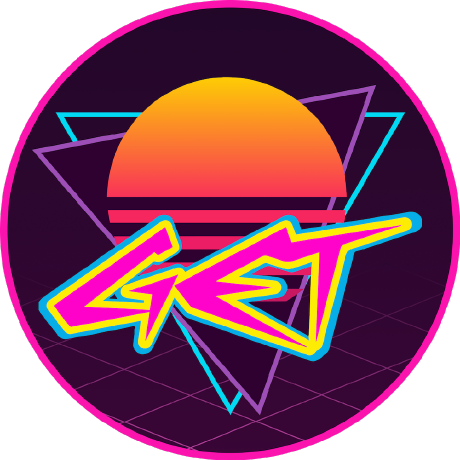

  

# GET - Gall & Etos Technology

[Back to all platforms](../profile/README.md)

**This guide describes GET's hiring process and technology stack. It does not
apply to other platforms in this organization.**

GET builds the software behind [Etos](https://www.etos.nl) and
[Gall & Gall](https://www.gall.nl), part of Ahold Delhaize.

If you are reading this, you have been invited to do a technical case with us.
Thank you for your time and interest; we're looking forward to building something
together.

This page explains how the interview works, what to do before it and what happens
on the day. The case itself appears in your private repository on the day of the
interview.

## Who we are

Etos and Gall & Gall have hundreds of stores across the Netherlands, plus webshops
and apps. GET is the tech organisation behind them: product teams that build and
run the services for products, prices, promotions, stores, suppliers and the tools
our colleagues use every day.

We combine the stability of a large enterprise with the pace of two smaller
retailers. Teams own their services end to end, from idea to production.

| Area | What we use |
| --- | --- |
| Backend | Python, FastAPI, Strawberry GraphQL, SQLAlchemy, `uv` |
| Frontend | React, Vite, Next.js, Tailwind, shadcn/ui |
| Data & events | PostgreSQL, Redis, Kafka |
| Platform | Docker, Kubernetes, Azure, GitHub Actions, Grafana |

You don't need to know all of these. We care much more about how you work than
about which tools you have used.

## How the interview works

### Before the interview

1. **Read this page.** It tells you who we are, what we build with and how the day
   works. There is nothing else to study: the case itself only appears on the day.
2. **Accept your invitation.** We create a private repository in this organisation
   just for you and invite you to it. Accept the invitation from your email or from
   [github.com/notifications](https://github.com/notifications), then clone the
   repository. It only holds a placeholder README for now; that's expected.
3. **Get your machine ready.** On the machine you will use for the interview, make
   sure you have:

   - [ ] Git, and access to your repository on GitHub
   - [ ] [Docker](https://docs.docker.com/get-docker/) with Compose **v2.22 or newer**
     (`docker compose version`), running and able to start containers
     (`docker run --rm hello-world`)
   - [ ] Ports `3000`, `5432`, `8000` and `8080` free
   - [ ] Your favourite editor or IDE, set up the way you like it
   - [ ] The [GitHub Copilot app](https://docs.github.com/en/copilot/concepts/copilot-surfaces/github-copilot-app)
     installed and signed in with the GitHub account you gave us, or your own AI
     coding agent ready to use

   We build with AI every day, and we expect you to use an AI coding agent during
   the case: a tool that can read your repository, run commands and make changes
   for you. We will provide a GitHub Copilot seat for your session; the easiest way
   to use it is with the GitHub Copilot app. You don't need your own Copilot
   subscription. If you prefer, you can bring and use your own AI coding agent.

If anything on this list doesn't work, let us know before the interview so we can
sort it out together.

### On the day

You will be interviewed in one of two three-hour slots, morning or afternoon:

| Duration | Morning | Afternoon | What happens |
| --- | --- | --- | --- |
| 45 min | 9:00 AM - 9:45 AM | 1:00 PM - 1:45 PM | **Getting to know each other.** A conversation about you, how you work and how we work. No laptop needed. |
| 5 min | 9:45 AM - 9:50 AM | 1:45 PM - 1:50 PM | **Break.** Grab a coffee while we push the case to your repository. |
| 10 min | 9:50 AM - 10:00 AM | 1:50 PM - 2:00 PM | **Introduction to the assignment.** We walk through the case, then you pull it, read the README and start the stack as described there. |
| 90 min | 10:00 AM - 11:30 AM | 2:00 PM - 3:30 PM | **Working on the assignment.** Pick up GitHub issues in the assignment repository and build on a small, realistic application from our retail domain. |
| 30 min | 11:30 AM - noon | 3:30 PM - 4:00 PM | **Joint review.** We look at what you built together and talk about your choices. |

The first start builds a few containers, so give it a couple of minutes. Work the
way you normally would, with your own editor and your AI coding agent. Nobody
watches over your shoulder, but you are not on your own: an engineer is available
throughout, so message them whenever you have a question or get stuck. Asking
questions is part of the job.

**We don't expect you to finish everything.** Doing a few issues well is better
than rushing through all of them. Commit and push your work before the review.

The review is a conversation, not a defence. Make sure you understand what your
agent produced: we will ask you about it.

## Good to know

- Your case repository is private. Ask your hiring contact if you have questions
  about who has access.
- Please don't share the case or publish your solution.
- We remove your access to the repository after the interview.

## Questions and contact

Contact the GET recruiter or engineer who arranged your interview if you have any
questions or need help preparing.

---

Good luck, and above all: have fun building!
